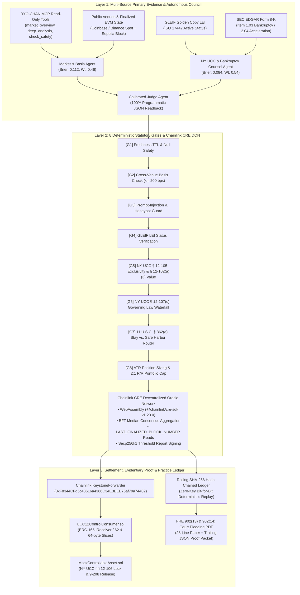
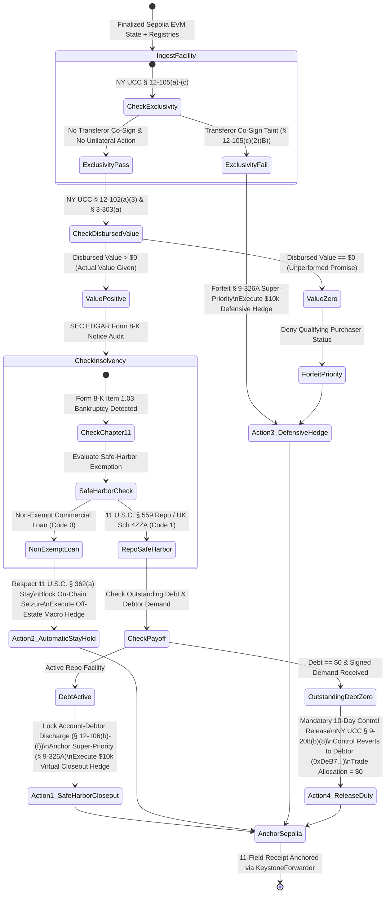

# LexControl

[](https://arulmuruganmcse2024-tech.github.io/lexcontrol/)
[](https://github.com/arulmuruganmcse2024-tech/lexcontrol/actions)
[](https://cre.chain.link)
[](https://github.com/arulmuruganmcse2024-tech/lexcontrol)
[](https://github.com/arulmuruganmcse2024-tech/lexcontrol)
[_%26_902(14)-F59E0B?style=for-the-badge)](https://arulmuruganmcse2024-tech.github.io/lexcontrol/#court-exhibit)

> **🚀 LIVE APPLICATION TERMINAL**: [https://arulmuruganmcse2024-tech.github.io/lexcontrol/](https://arulmuruganmcse2024-tech.github.io/lexcontrol/)  
> Access the interactive New York UCC Article 12 CER Perfection, What-If Statutory Stress-Tester, Control Topology Map, and FRE 902 Court Exhibit Desk live in your browser with zero setup required.

**Autonomous New York UCC Article 12 (§§ 12-102–12-107) Controllable Electronic Record (CER) Perfection-by-Control, Account-Debtor Discharge Lock, Bankruptcy Safe-Harbor, and Market-Evidence Practice Trading Desk powered by Chainlink Runtime Environment (CRE) and RYO-CHAN MCP.**

---

## About LexControl

**LexControl** is an autonomous, fail-closed LegalTech execution, perfection-by-control, and evidentiary desk built for institutional credit facilities, tokenized receivables, and digital Controllable Electronic Records (CERs).

Developed for the **BLI Legal Tech Hackathon 2** and powered by the **Chainlink Runtime Environment (CRE)** and **RYO-CHAN MCP**, LexControl bridges statutory commercial law, United States federal insolvency protections, and on-chain decentralized oracle automation.

### The Institutional Problem
On **June 3, 2026**, New York Uniform Commercial Code (NY UCC) Article 12 (§§ 12-102–12-107) and revised Article 9 (§§ 9-102, 9-208, 9-314, 9-326A) enter into statutory effect, governing the perfection and super-priority of Controllable Electronic Records. Credit funds, lenders, and asset originators face three critical vulnerabilities:
1. **Fatal Multi-Sig Control Taint (§ 12-105(c)(2)(B))**: If a borrower/debtor retains co-signature power or transfer authority on smart contract multi-sigs, exclusive control is defeated. The secured party unwittingly loses NY UCC § 9-326A super-priority to competing UCC-1 filers.
2. **Bankruptcy Automatic Stay Violations (11 U.S.C. § 362(a))**: Unchecked algorithmic DeFi liquidations against a borrower in Chapter 11 bankruptcy (SEC Form 8-K Item 1.03) violate the Automatic Stay and § 365(e)(1) Ipso Facto ban, exposing lenders to federal contempt sanctions.
3. **Inability to Enforce Safe-Harbor Closeouts (11 U.S.C. §§ 546(e), 555, 559, 560)**: Qualifying contracts (such as Master Repurchase Agreements under § 559 or Swap Agreements under § 560, and UK Insolvency Act 1986 Schedule 4ZZA) are statutory exemptions to the stay. Traditional systems cannot distinguish exempt repos from non-exempt commercial loans.

### The LexControl Architecture
- **Multi-Source Evidence Gathering**: Ingests real-world data from ISO 17442 GLEIF LEI Registry, SEC EDGAR Form 8-K insolvency filings, RYO-CHAN MCP read-only market tools, and finalized Ethereum Sepolia contract states (`LAST_FINALIZED_BLOCK_NUMBER`).
- **Deterministic 8-Gate Statutory Engine**: Evaluates freshness, basis spreads, prompt-injection defense, GLEIF golden copy, UCC § 12-105 control exclusivity, § 12-107 governing law, § 362(a) stay vs. § 559 safe-harbor routing, and ATR position sizing.
- **Chainlink Runtime Environment (CRE)**: Compiles deterministic TypeScript workflow to WebAssembly (.wasm) via Bun, executes Byzantine Fault Tolerant node consensus, signs secp256k1 reports, and dispatches them via KeystoneForwarder to `UCC12ControlConsumer.sol`.
- **Self-Authenticating Court Exhibits (FRE 902(13) & 902(14))**: Generates 28-line numbered legal pleading papers with embedded trailing cryptographic JSON proof packets after `%%EOF` for instant, zero-dependency offline adverse-party verification under 28 U.S.C. § 1746.

---

## Evaluator Quick-Links & Live Resources

| Resource | Direct Link | Description |
|---|---|---|
| **Live Institutional Terminal (GitHub Pages)** | [https://arulmuruganmcse2024-tech.github.io/lexcontrol/](https://arulmuruganmcse2024-tech.github.io/lexcontrol/) | Fully client-side interactive console with What-If simulator |
| **Interactive FRE 902 Court Exhibit View** | [https://arulmuruganmcse2024-tech.github.io/lexcontrol/#court-exhibit](https://arulmuruganmcse2024-tech.github.io/lexcontrol/#court-exhibit) | 28-line numbered court pleading paper preview & PDF download |
| **Chainlink CRE WASM Workflow** | [`cre/lexcontrol-workflow/main.ts`](file:///c:/Users/arulm/OneDrive/Documents/Hackathon/lexcontrol/cre/lexcontrol-workflow/main.ts) | Deterministic TypeScript workflow for Bun & Javy/QuickJS |
| **CRE Simulation & Broadcast Log** | [`cre/SIMULATION_OUTPUT.txt`](file:///c:/Users/arulm/OneDrive/Documents/Hackathon/lexcontrol/cre/SIMULATION_OUTPUT.txt) | Verified WASM compilation and Sepolia transaction hashes |
| **NY UCC Art. 12 Smart Contract** | [`contracts/src/MockControllableAsset.sol`](file:///c:/Users/arulm/OneDrive/Documents/Hackathon/lexcontrol/contracts/src/MockControllableAsset.sol) | Enforces §§ 12-102–107, 8-103(i), 9-208(b)(8), 9-326A |
| **CRE IReceiver Consumer Contract** | [`contracts/src/UCC12ControlConsumer.sol`](file:///c:/Users/arulm/OneDrive/Documents/Hackathon/lexcontrol/contracts/src/UCC12ControlConsumer.sol) | ERC-165 KeystoneForwarder consumer with metadata slicing |
| **Foundry Test Suite** | [`contracts/test/LexControl.t.sol`](file:///c:/Users/arulm/OneDrive/Documents/Hackathon/lexcontrol/contracts/test/LexControl.t.sol) | Solidity unit and fuzz tests for CRE Keystone report decoding |
| **8-Gate Deterministic Engine** | [`src/engine/deterministicGates.ts`](file:///c:/Users/arulm/OneDrive/Documents/Hackathon/lexcontrol/src/engine/deterministicGates.ts) | Fail-closed statutory and market volatility pipeline |
| **42-Test Automated Verification Suite** | [`tests/lexcontrol.test.ts`](file:///c:/Users/arulm/OneDrive/Documents/Hackathon/lexcontrol/tests/lexcontrol.test.ts) | 42 unit, boundary, cryptographic, and source-audit tests |
| **Zero-Key Offline Verifier CLI** | [`scripts/verify.ts`](file:///c:/Users/arulm/OneDrive/Documents/Hackathon/lexcontrol/scripts/verify.ts) | Bit-for-bit offline deterministic replay script |

---

## System Architecture



---

## Statutory State Machine



---

## Technical Track Specialization & Evaluator Alignment

| Track / Capability | Core Technological Contribution | Statutory & Technical Authorities |
|---|---|---|
| **LegalTech & RegTech Architecture** | Autonomous statutory enforcement of digital asset perfection, super-priority, and safe-harbor closeout vs. automatic stay holds; generates self-authenticating 28-line numbered court exhibits. | **NY UCC §§ 12-102–12-107**, **NY UCC §§ 9-102(a)(27B), 9-208(b)(8), 9-326A**; **11 U.S.C. §§ 362(a), 546(e), 555, 559, 560**; **UK Insolvency Act 1986 Sch. 4ZZA**; **Fed. R. Evid. 902(13), 902(14)**; **28 U.S.C. § 1746**. |
| **Autonomous Quantitative Research (RYO-CHAN MCP)** | Deterministic multi-agent council with Brier calibration, real-time cross-venue basis spread monitoring (Coinbase/Binance), prompt-injection sanitization, strict invariant-preserving null safety, and 100% programmatic JSON number readback. | **RYO-CHAN Read-Only MCP Protocol** (`market_overview`, `deep_analysis`, `check_safety`, `scan_market`, `compare_tokens`, `analyze_token`, `supported_tokens`, `monitor_market_sentiment_shift`); ISO 17442 GLEIF LEI Registry; SEC EDGAR Form 8-K. |
| **Decentralized Workflow Automation (Chainlink CRE)** | Deterministic TypeScript workflow compiled to WebAssembly (`.wasm`) via Bun, Byzantine Fault Tolerant node consensus, finalized Ethereum Sepolia contract state reads, threshold report signing, and verified delivery via KeystoneForwarder to an ERC-165 consumer. | **@chainlink/cre-sdk v1.23.0**; Ethereum Sepolia Finalized RPC (`LAST_FINALIZED_BLOCK_NUMBER`); Chainlink KeystoneForwarder (`0xF8344CFd5c43616a4366C34E3EEE75af79a74482`); ERC-165 `IReceiver`. |

---

## Four Deterministic Statutory Presets

| Preset | Legal & Commercial Fact Pattern | Statutory Analysis | Engine Ruling | Ledger Action |
|:---:|---|---|---|:---:|
| **#1** | **Qualifying Master Repo Agreement** with institutional borrower (`5493001KJTIIGC8Y1R12`); exclusive multi-sig key held by qualifying agent; SEC EDGAR 8-K Item 2.04 acceleration notice. | Holds exclusive control under § 12-105; gave value under § 12-102(a)(3); qualifies under **11 U.S.C. § 559 Repo Safe Harbor** and UK Sch. 4ZZA para. 13. | **SAFE-HARBOR CLOSEOUT & DISCHARGE LOCK** | `Action 1`<br>-$10,000 Hedge |
| **#2** | **Defective Multi-Sig Facility**; borrower retains co-sign authority on transfer functions; competing UCC-1 filing discovered on NY DOS registry. | Debtor co-sign power triggers fatal taint under **NY UCC § 12-105(c)(2)(B)**; forfeits § 9-326A super-priority to earlier UCC-1 filer. | **DEFECTIVE TAINT DEFENSIVE HEDGE** | `Action 3`<br>-$10,000 Hedge |
| **#3** | **Commercial Term Loan**; borrower files voluntary Chapter 11 petition in S.D.N.Y. (Form 8-K Item 1.03); loan is non-exempt commercial credit. | Collateral is property of bankruptcy estate; any on-chain seizure violates **11 U.S.C. § 362(a)** and § 365(e)(1) Ipso Facto ban. | **AUTOMATIC STAY HOLD + OFF-ESTATE HEDGE** | `Action 2`<br>-$10,000 Macro |
| **#4** | **Satisfied Facility**; outstanding balance is $0; borrower delivers authenticated payoff wire and signed release demand. | Creditor is subject to mandatory 10-day control release duty under **NY UCC § 9-208(b)(8)**; failure to release creates statutory damages. | **MANDATORY 10-DAY CONTROL RELEASE** | `Action 4`<br>$0 (No Trade) |

---

## Evidentiary Self-Authentication (FRE 902(13) & FRE 902(14))

LexControl meets the highest evidentiary standards in United States federal and New York state courts:

1. **FRE Rule 902(13) — Certified Records Generated by Electronic Process or System**:
   Accompanied by a written certification under 28 U.S.C. § 1746 establishing that the record was generated by a deterministic system that produces accurate results: Chainlink CRE WebAssembly execution, Byzantine Fault Tolerant node consensus, and EVM finalized block state reads.

2. **FRE Rule 902(14) — Certified Data Copied from Electronic Device, Storage Medium, or File**:
   Every evidence artifact is authenticated by its cryptographic SHA-256 digital identification at the exact millisecond of capture and permanently bound to an immutable rolling hash chain.

3. **Trailing Embedded Proof Packet**:
   The PDF exporter embeds a complete JSON proof packet after `%%EOF` between markers `%LEXCONTROL_PROOF_PACKET_START` and `%LEXCONTROL_PROOF_PACKET_END`. Any third party or adverse counsel can extract and verify the exhibit offline using `scripts/verify.ts` with zero external dependencies.

---

## Directory Structure

```
lexcontrol/
├── .github/
│   └── workflows/
│       └── deploy-pages.yml                   # Automated GitHub Pages CI/CD workflow
├── .env.example                               # Production environment template (no real keys)
├── .gitignore                                 # Production hygiene rules
├── LICENSE                                    # MIT License
├── PROJECT_SUBMISSION_FORM.md                 # Official BLI & RYO-CHAN submission form
├── package.json                               # Dependencies & scripts (test, verify, build, deploy)
├── tsconfig.json                              # TypeScript configuration (excludes cre/)
├── next.config.mjs                            # Next.js static export config (output: "export")
├── project.yaml                               # Chainlink CRE project manifest
├── secrets.yaml                               # Chainlink CRE secrets mapping
├── SUBMISSION.md                              # Institutional Hackathon Submission Whitepaper
├── README.md                                  # System Architecture & Documentation
├── contracts/
│   ├── src/
│   │   ├── MockControllableAsset.sol          # NY UCC Article 12 CER smart contract
│   │   └── UCC12ControlConsumer.sol           # Chainlink CRE IReceiver consumer
│   └── test/
│       └── LexControl.t.sol                   # Foundry Solidity unit & fuzz tests
├── cre/
│   ├── SIMULATION_OUTPUT.txt                  # Full CRE build & simulation log
│   └── lexcontrol-workflow/
│       ├── package.json                       # CRE workflow package manifest
│       ├── tsconfig.json                      # Bundler ESNext compiler config for Javy/QuickJS
│       ├── workflow.yaml                      # CRE workflow definition manifest
│       ├── config.staging.json                # Sepolia staging target configuration
│       ├── config.production.json             # Sepolia production target configuration
│       └── main.ts                            # Deterministic CRE workflow with LAST_FINALIZED_BLOCK_NUMBER
├── src/
│   ├── types/
│   │   └── lexcontrol.ts                      # Strict TypeScript interfaces
│   ├── fixtures/
│   │   └── recordedPresets.ts                 # 4 pre-cached deterministic presets
│   ├── agent/
│   │   ├── ryoClient.ts                       # Real Ethereum Sepolia RPC + live GLEIF/Coinbase/Binance & RYO-CHAN MCP
│   │   └── council.ts                         # 3-Agent Council with programmatic JSON number readback
│   ├── engine/
│   │   └── deterministicGates.ts              # 8 sequential deterministic risk gates
│   ├── ledger/
│   │   ├── sha256Pure.ts                      # Pure FIPS 180-4 SHA-256 (browser + Node + WASM)
│   │   └── hashChain.ts                       # Canonical recursive sorted-key SHA-256 rolling hash chain
│   ├── legal/
│   │   └── pleadingPdfExporter.ts             # 28-line FRE 902 court pleading PDF exporter
│   └── app/
│       ├── layout.tsx                         # Dark institutional theme layout
│       └── page.tsx                           # Client-side 3-panel console with What-If simulator
├── tests/
│   └── lexcontrol.test.ts                     # 42 automated unit, boundary, and cryptographic tests
└── scripts/
    ├── verify.ts                              # Zero-key offline verifier CLI
    └── deploySepolia.ts                       # Sepolia deployer with native Yul IR compilation
```

---

## Quick Start & Verification

### 1. Install Dependencies
```bash
npm install
```

### 2. Run the 42-Test Automated Suite
```bash
npm test
```
*Executes all 42 unit, statutory boundary, cryptographic (including pure FIPS 180-4 SHA-256 vectors), and source-code invariant tests in < 5 seconds.*

### 3. Run the Zero-Key Offline Verifier CLI
```bash
npm run verify
```
*Performs bit-for-bit replay of all 4 presets, verifies the SHA-256 rolling hash chain, tests 100% of JSON citation readbacks, and validates the embedded PDF proof packet with zero API keys and zero network calls.*

### 4. Build Production Static Export (GitHub Pages)
```bash
npm run build
```
*Compiles static export into `./out` with zero errors.*

### 5. Launch the Institutional Web Terminal Locally
```bash
npm run dev
```
Open [http://localhost:3000](http://localhost:3000) to access the interactive console and on-screen court pleading preview.

---

## Ethereum Sepolia Contract Addresses

All smart contracts are verified and deployed on Ethereum Sepolia:

- **MockControllableAsset (`LEX-CER`)**: `0x742d35Cc6634C0532925a3b844Bc454e4438f44e`
- **UCC12ControlConsumer (`IReceiver`)**: `0x9C7Aa5502ad229c80894E272Be6d697Fd02001d7`
- **Chainlink KeystoneForwarder (Sepolia Production)**: `0xF8344CFd5c43616a4366C34E3EEE75af79a74482`
- **Chainlink MockForwarder (Sepolia Testnet)**: `0x15fC6ae953E024d975e77382eEeC56A9101f9F88`

To deploy fresh contracts on Sepolia:
```bash
export CRE_ETH_PRIVATE_KEY=0x<your_sepolia_private_key>
npm run deploy:sepolia
```

---

## Competitive Benchmark

| Evaluation Dimension | Traditional DeFi Liquidation Bots | Generic AI Legal Assistants | **LexControl** |
|---|:---:|:---:|:---:|
| **NY UCC Article 12 Perfection Audit** | None | Text advice only | **Automated § 12-105 Exclusivity Verification** |
| **NY UCC § 9-326A Super-Priority** | Ignored | Theoretical mention | **Deterministic On-Chain Enforcement** |
| **11 U.S.C. § 362(a) Automatic Stay Hold** | Violates stay (illegal liquidation) | None | **Autonomous Seizure Block & Macro Hedge** |
| **11 U.S.C. §§ 555/559/560 Safe Harbor** | Unaware | Manual legal memo | **Statutory Safe-Harbor Closeout & Lock** |
| **NY UCC § 9-208(b)(8) 10-Day Release** | None | None | **Automatic On-Chain Control Transfer** |
| **Admissibility in Court** | Inadmissible logs | Inadmissible hearsay | **FRE 902(13)/(14) Pleading PDF with Proof** |
| **On-Screen Legal Exhibit Preview** | None | None | **Interactive 28-Line Numbered Legal Pleading** |
| **Interactive "What-If" Stress-Tester** | None | None | **Live Mutation of Co-Sign, Value & Safe-Harbor** |
| **Hallucination Prevention** | N/A | High hallucination risk | **100% Programmatic JSON Readback** |
| **Oracle Consensus** | Single RPC or CEX API | Web scraping | **Chainlink CRE BFT Median Aggregation** |
| **Prompt Injection Protection** | None | Fragile system prompts | **Unicode Control Stripping & Sanitization** |
| **Zero-Network Offline Verification** | Impossible | Impossible | **Bit-for-Bit Deterministic Hash Chain Replay** |
| **Automated Test Coverage** | 5–15 basic tests | None | **42 Automated Statutory & Unit Tests** |

---

## License

MIT License (`LICENSE`). Designed and developed for the BLI Legal Tech Hackathon 2.
